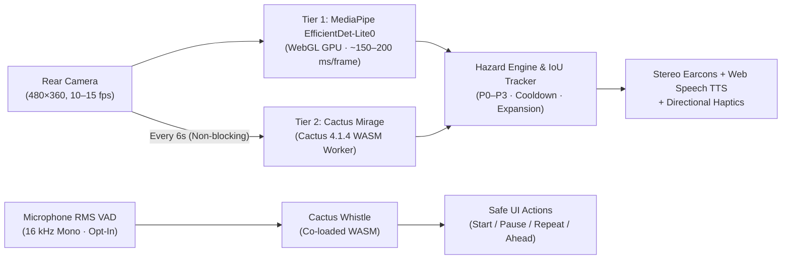

<div align="center">


# Drishti AI — दृष्टि

**See the path. Hear the world.**  
An offline-first, privacy-preserving assistive mobility companion for blind and low-vision pedestrians in India.

[](LICENSE)
[](.github/workflows/ci.yml)
[](#architecture)
[](#android-setup--usb-testing)

</div>

---

> [!IMPORTANT]
> **Experimental Assistive Tool — Non-Negotiable Safety Boundaries**
> - **Not a primary mobility aid:** Always use alongside a white cane, guide dog, Orientation & Mobility (O&M) training, or human assistance.
> - **No crossing decisions:** Drishti AI will **never** claim *"the road is safe"* or *"you can cross now."*
> - **No unverified hazards or distances:** Custom Indian ground drop-offs (`pothole`, `open_drain`, `open_manhole`, `broken_footpath`, `auto_rickshaw`) remain disabled (`enabled: false`) in [`mirageRegistry.ts`](frontend/src/ai/mirage/mirageRegistry.ts) until custom dataset weights are trained and verified. Distance meters are never invented; approaching-hazard cues trigger only when rapid multi-frame bounding-box expansion (`≥ 25%`) is directly measured.
> - **100% On-Device Privacy:** Zero camera frames or microphone clips leave the device.

---

## Why Drishti AI

Blind and low-vision pedestrians need **sub-250 ms feedback**, **hands-free audio**, and **offline reliability** without cloud latency or subscription costs. Drishti AI combines a real-time GPU object detector for walking-speed collision alerts with Cactus Compute's WebAssembly models for open-vocabulary scene context and offline voice control—wrapped in the high-contrast **Royal Ivory & Royal Obsidian** accessibility UI.

### Key Capabilities

| Capability | Implementation |
| --- | --- |
| **Two-Tier On-Device Vision** | **Tier 1:** MediaPipe EfficientDet-Lite0 (`GPU` WebGL with `CPU` fallback) at **150–200 ms/frame** on Snapdragon 4 Gen 1.<br>**Tier 2:** Non-blocking **Cactus Mirage** (`mirage.cact`) every 6s for open-vocabulary static hazards (`stairs`, `barrier`, `tree`, `trash can`). |
| **Approaching-Hazard Detection** | Tracks bounding-box expansion across `≥ 4` rapid frames (`≤ 600 ms` frame gap) to flag `P0` approaching dynamic hazards in the walking corridor. |
| **3D Stereo Audio & Haptics** | Web Audio `StereoPannerNode` left (`-0.85`), center (`0`), and right (`+0.85`) chimes paired with Web Speech (`en-IN`), a throttled 2s scanning heartbeat tick, and directional `navigator.vibrate` cadences. |
| **Offline Voice Commands (Opt-In)** | **Cactus Whistle** (`whistle.cact`) co-loaded in WASM with an RMS voice-activity detector supporting *"Start"*, *"Pause"*, *"Repeat"*, *"What is ahead"*, *"Faster"*, and *"Slower"*. |
| **Adaptive Battery Saver** | `DeviceMotionEvent` motion monitor slows scanning when standing still with no urgent hazards and restores full speed on movement. |
| **Accessible Stitch Design System** | Royal Ivory (Light) & Royal Obsidian (Dark) themes, scalable text sizes (`Default`, `Large`, `Extra`), `prefers-reduced-motion` support, large tactile touch targets, and ARIA live announcements. |

---

## Architecture



### Bundled Models & Measured Benchmarks

All model binaries are verified at runtime using **byte-length + SHA-256 checksums** (`modelCache.ts`) and precached offline by Workbox (`24 entries`, `~58.6 MB` total):

| Model | Role | Size | Runtime | Measured Benchmark | License |
| --- | --- | --- | --- | --- | --- |
| [`efficientdet_lite0.tflite`](frontend/public/models/efficientdet_lite0.tflite) | Tier 1 Real-Time Obstacles | 4.4 MB | `@mediapipe/tasks-vision` (GPU/CPU) | **150–200 ms/frame** on Android (`I2127`, Snapdragon 4 Gen 1 Chrome) | Apache-2.0 |
| [`mirage.cact`](frontend/public/models/mirage.cact) | Tier 2 Scene Context | 20.6 MB | Cactus Compute `4.1.4` WASM | **967–979 ms** median (Apple Silicon Node WASM); **2,500+ ms** on `I2127` CPU WASM | Apache-2.0 |
| [`whistle.cact`](frontend/public/models/whistle.cact) | Offline Voice Commands | 16.1 MB | Cactus Compute `4.1.4` WASM | **69 ms** transcription (`136.4 tok/s`, **86 MB** combined WASM heap in Node) | Apache-2.0 |

---

## Getting Started

### Prerequisites
- **Node.js** `22+` and **npm** `10+`
- **Python** `3.10+` (optional, for dataset validation & training scripts)
- **adb** (`android-platform-tools`) for USB phone testing; **Android Studio / Android SDK (API 36)** for `.apk` builds

### Local Web Development

```bash
cd frontend
npm install
npm run dev
```

### Verification & Production Build

```bash
cd frontend
npx tsc -b --noEmit   # TypeScript strict check
npm test              # 13 Vitest suites / 32 unit & WASM integration tests
npm run cap:sync      # Builds dist/ PWA and syncs Capacitor Android assets
```

To run the Python dataset validation tests from the repository root:

```bash
python3 -m unittest discover -s ai-training/scripts -p "test_*.py"
```

---

## Android Setup & USB Testing

Android Chrome requires a secure origin (`http://localhost` or `https://`) for rear camera, microphone, Service Worker, and Web Crypto SHA-256 verification.

### Fast USB PWA Testing (Recommended)
1. Enable **Developer Options → USB Debugging** on your Android phone and connect via USB.
2. Build, serve, and forward port `4173`:
   ```bash
   cd frontend
   npm run build
   npx vite preview --port 4173 --strictPort
   ```
   In another terminal:
   ```bash
   adb reverse tcp:4173 tcp:4173
   adb shell am start -a android.intent.action.VIEW -d "http://localhost:4173"
   ```

### Native Android APK (`frontend/android/`)
1. Sync web assets: `cd frontend && npm run cap:sync`
2. Open `frontend/android/` in **Android Studio** (or build via Gradle with Android SDK API 36 & JDK 17/21):
   ```bash
   cd frontend/android
   ./gradlew assembleDebug
   ```

---

## Custom Dataset Evaluation & Fine-Tuning (`ai-training/`)

Drishti AI includes an evaluation and training pipeline aligned with [**ROD-Dataset**](https://huggingface.co/datasets/Abtinzandi/Obstacle-Detection-Dataset-YOLO) (24,326 smartphone pedestrian-perspective images across 25 classes, MIT License):

- **Label Validator:** `python3 ai-training/scripts/validate_yolo_dataset.py --labels <dir> --num-classes 25`
- **Mirage WASM Evaluator:** `node ai-training/scripts/evaluate_rod_mirage.mjs`
  - Measured recall across 32 balanced `ROD-Dataset` test images: `Motorcycle` **4/4**, `Electrical Pole` **3/4**, `Traffic Cone` **3/4**, `Dog` **3/4**, `Stairs` **2/4** (`+1 railing`), `Dustbin` **1/4** (`trash can`), `Manhole` **0/4** (confirming custom detector training is required before enabling ground drop-off classes).
- **YOLO11n Quantized Trainer (Colab / GPU):**
  ```bash
  pip install ultralytics huggingface_hub
  python3 ai-training/scripts/train_rod_detector.py --epochs 50 --imgsz 320
  ```

---

## Repository Structure

```text
Drishti AI/
├── .github/workflows/ci.yml        # Typecheck, Vitest, Capacitor sync, and Python validator CI
├── ai-models/model-manifest.json   # Single source of truth for runtime & model SHA-256 digests
├── ai-training/                    # Dataset schemas (rod_dataset.yaml, drishti_indian_hazards.yaml) & scripts
├── docs/                           # ARCHITECTURE.md, BUILD_STATUS.md, SAFETY.md, DATASET_GUIDE.md, TESTING.md
├── frontend/
│   ├── android/                    # Capacitor Android wrapper project
│   ├── public/
│   │   ├── cactus/                 # Official Cactus Compute 4.1.4 WASM runtime
│   │   ├── mediapipe/              # MediaPipe Vision WASM runtime
│   │   └── models/                 # efficientdet_lite0.tflite, mirage.cact, whistle.cact, manifest
│   └── src/
│       ├── ai/                     # fastDetectorService, mirageService, mirageAdapter, mirageRegistry, modelCache
│       ├── camera/                 # cameraManager (AbortSignal, freeze/interruption recovery) & adaptiveScheduler
│       ├── safety/                 # hazardEngine (IoU tracking, expansion) & directionEstimator
│       ├── voice/                  # voiceEngine (TTS, StereoPannerNode, haptics), microphoneVad, voiceCommandParser
│       ├── screens/                # OnboardingView, SettingsView, OfflineStatusView, SafetyView
│       └── workers/mirage.worker.ts
└── LICENSE                         # Apache License 2.0
```

---

## Documentation

- [Architecture Overview](docs/ARCHITECTURE.md)
- [Build Status & Device Benchmarks](docs/BUILD_STATUS.md)
- [Safety & Limitations](docs/SAFETY.md)
- [Dataset Collection Guide](docs/DATASET_GUIDE.md)
- [Model Training & Evaluation](docs/MODEL_TRAINING.md)
- [Device Validation](docs/DEVICE_VALIDATION.md)

## License

Licensed under the **Apache License 2.0** — see [`LICENSE`](LICENSE).
